# Text-to-Learn: AI-Powered Course Generator

Type any topic ("Intro to React Hooks", "Basics of Copyright Law") and Text-to-Learn builds a
structured online course: 3–6 modules of 3–5 lessons, each with objectives, explanations, code,
an embedded YouTube video, a quiz and further reading. Lessons can be downloaded as PDF, explained
aloud in Hinglish, tracked as you study, and shared with a read-only link.

**Live demo:** _add the Vercel URL after deploying_ · **API:** _add the Render URL_ ·
**Demo video:** _add the link_

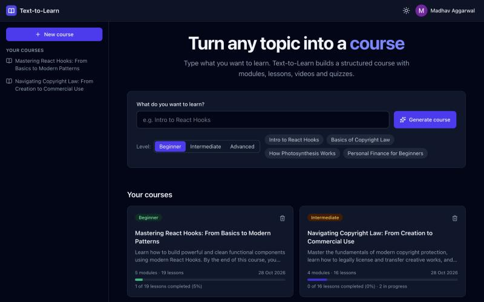

## Features

- **Prompt → course:** a topic and level become a course outline in a few seconds; each lesson's
  full content is written the first time it is opened.
- **Rich lessons:** formatted explanations, syntax-highlighted code with copy, an embedded YouTube
  video, an interactive quiz with explanations, and checked further-reading links.
- **Hinglish audio:** a spoken Hinglish explanation of any lesson (Gemini script + text-to-speech),
  with transcript and download.
- **PDF download:** a paginated A4 PDF of the lesson with an answer key and clickable links.
- **Progress:** mark lessons complete; quiz scores are graded and saved by the server; progress bars
  and per-lesson status everywhere.
- **Sharing:** a read-only public link to a course, with no account needed to view it.
- **Accounts:** Auth0 login; every course belongs to its creator.
- **Polish:** responsive layout with a mobile drawer, light/dark theme, loading and error states
  everywhere, and a banner while the free-tier server wakes up.

## Screenshots

| Course overview with progress (light theme)   | Lesson page                                   |
| --------------------------------------------- | --------------------------------------------- |
| 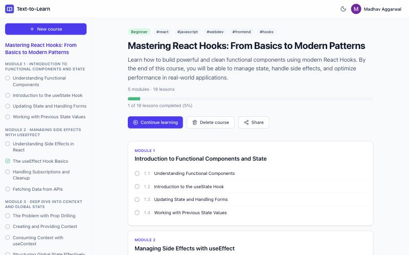   | 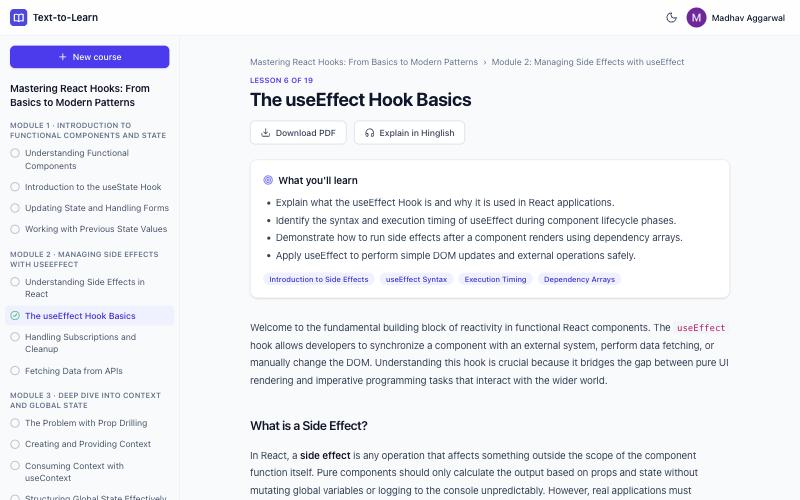   |
| **Explanations and highlighted code**         | **Quiz with feedback and saved best score**   |
| 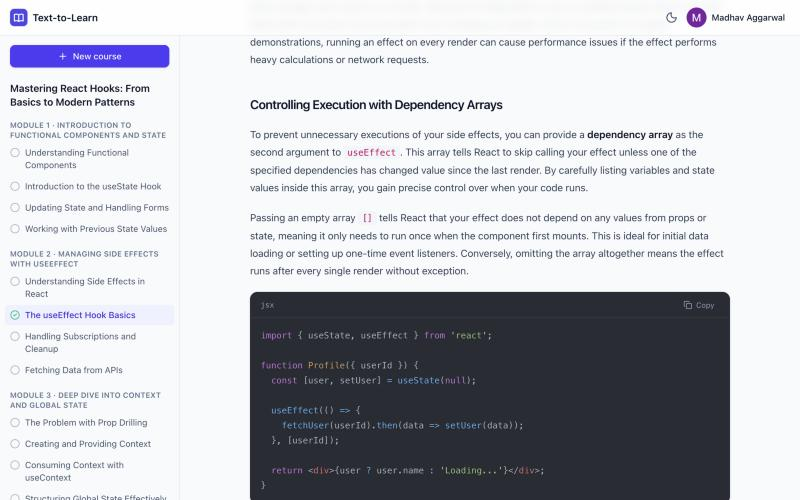      | 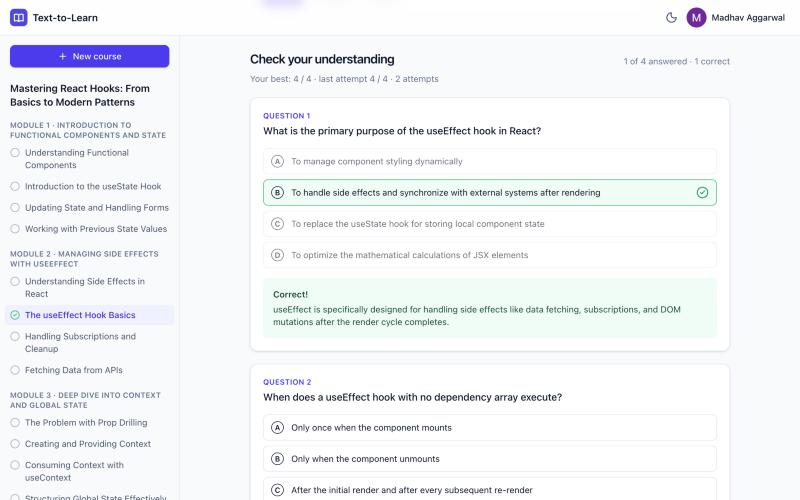            |
| **Hinglish audio with transcript**            | **Downloaded PDF (page 1 and the quiz page)** |
| 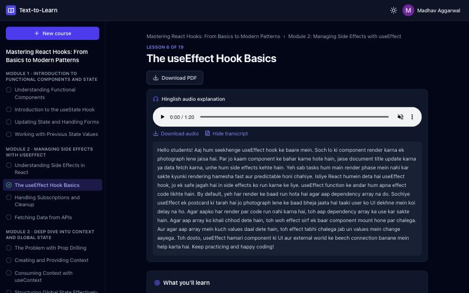 | 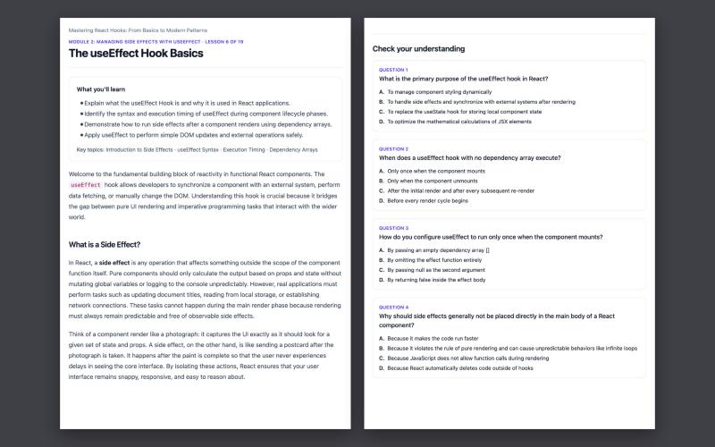        |
| **Shared, read-only course**                  | **Mobile**                                    |
| 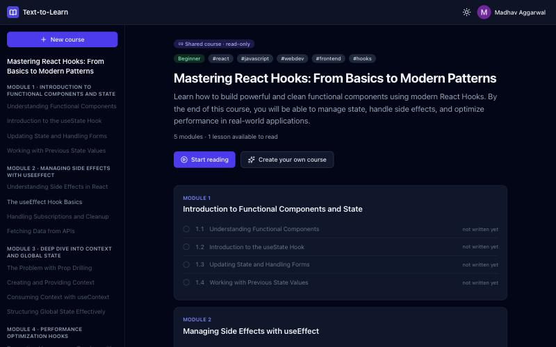 | 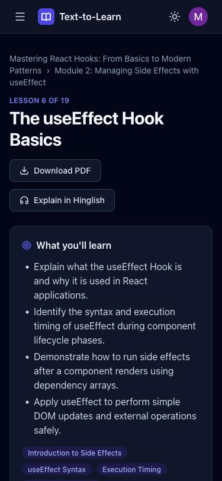 |

## Architecture

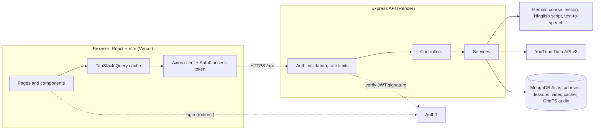

What happens when a lesson is opened for the first time:

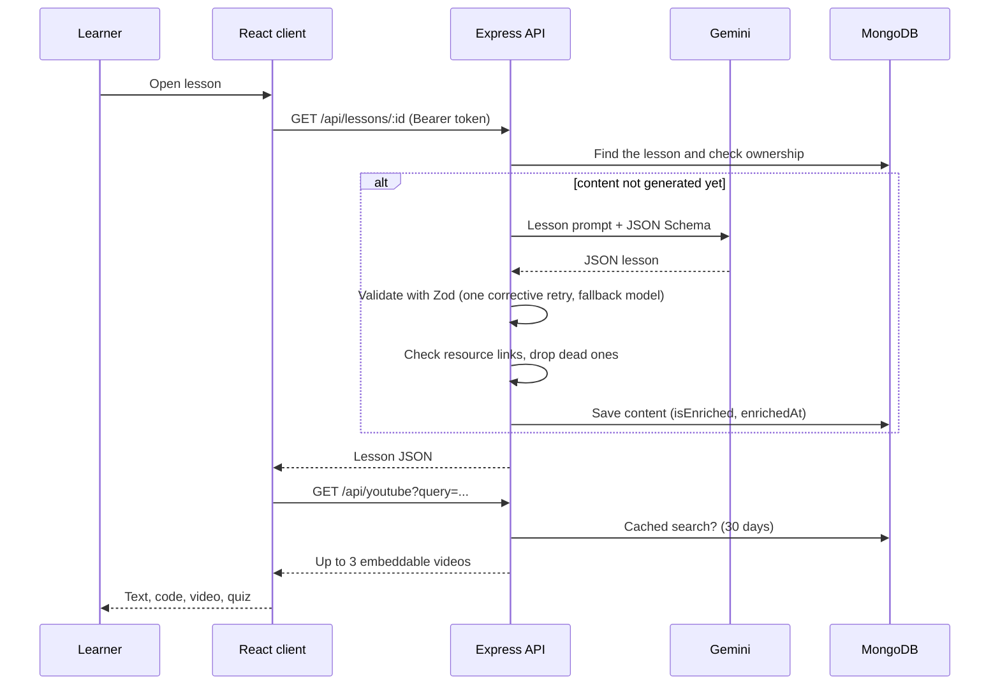

### Data model

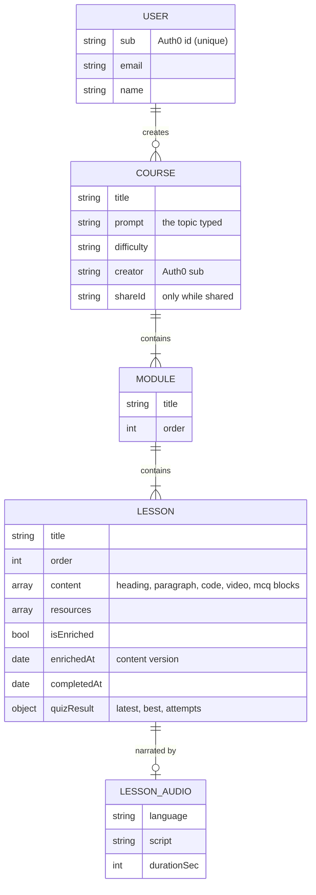

Lessons also reference their course directly, so ownership checks need one lookup. YouTube results
live in a separate `videocaches` collection that expires entries after 30 days. Audio WAV files are
stored in GridFS (`lessonAudio`).

## Tech stack

| Layer    | Tech                                                                               |
| -------- | ---------------------------------------------------------------------------------- |
| Frontend | React 19, Vite, Tailwind CSS v4, React Router, TanStack Query, Axios, lucide-react |
| Lessons  | prism-react-renderer (code), jsPDF + html2canvas-pro (PDF)                         |
| Backend  | Node.js, Express 5, Mongoose (MongoDB Atlas, GridFS), Zod                          |
| AI       | Google Gemini via `@google/genai` (structured JSON output, text-to-speech)         |
| Services | Auth0 (OAuth 2.0 / JWT), YouTube Data API v3                                       |
| Quality  | Vitest, Supertest, mongodb-memory-server, Testing Library, ESLint, Prettier        |
| Delivery | GitHub Actions CI, Dependabot, Render (API), Vercel (client)                       |

## How generation works

1. **Outline:** the topic goes to Gemini with a JSON Schema built from the
   [Zod schemas](server/src/prompts/schemas.js); the reply is validated (3–6 modules × 3–5 lessons).
2. **Lessons:** each lesson's content (objectives, key topics, text, code, a video search query,
   3–5 MCQs, resources) is generated the first time it is opened, then validated the same way.
3. **Reliability:** invalid output is retried once with the validation errors attached; if the main
   model times out or is overloaded, a fallback model is used. AI-suggested links are checked and
   dead ones dropped.
4. **Videos:** the lesson's AI-written search query goes to the YouTube Data API on the server
   (the key never reaches the browser), filtered to embeddable, safe-search videos. Results are
   cached in MongoDB per query for 30 days. The lesson shows the top 3 as a thumbnail that loads
   the privacy-enhanced `youtube-nocookie.com` player on click.
5. **Hinglish audio:** on request, Gemini rewrites the lesson as a ~200-word spoken explanation in
   Hinglish (Roman script, English technical terms), validated like the other AI output, and a
   Gemini text-to-speech model reads it (WAV, ~1.5 minutes, ~20 s to make). The WAV is stored in
   GridFS with its transcript and deleted when the lesson is regenerated or its course deleted.

Measured with the default models: outlines in 2–5 s, lessons in 6–10 s (510–830 words), Hinglish
audio in ~16–20 s for 80+ seconds of speech. `npm run ai:try --prefix server` reproduces the
text timings on sample topics.

## Design decisions

| Decision                                            | Why                                                                                                                                                                                                      |
| --------------------------------------------------- | -------------------------------------------------------------------------------------------------------------------------------------------------------------------------------------------------------- |
| **Generate lessons lazily** (on first open)         | A full course is ~20 lessons: writing them all up front would take minutes and spend quota on lessons nobody reads. The outline is ready in seconds.                                                     |
| **One Zod schema both steers and validates the AI** | The same definition becomes Gemini's JSON Schema and the check on its reply, so they can't drift apart. Invalid output gets one retry with the exact errors.                                             |
| **Fallback models and per-call timeouts**           | Gemini models were sometimes slow or overloaded during development; a request switches models instead of hanging. The SDK's own retries (up to minutes) are disabled.                                    |
| **Server-side YouTube with a 30-day cache**         | The free quota allows ~100 searches a day; the key also stays secret. Shared-course visitors only ever read the cache.                                                                                   |
| **Click-to-play video**                             | Each YouTube player is ~1 MB and sets cookies; a thumbnail keeps lessons fast and private until the learner chooses to watch.                                                                            |
| **Quiz graded on the server**                       | The stored answers are the source of truth for saved scores; a pass (≥ 60%) completes the lesson.                                                                                                        |
| **`enrichedAt` as the content version**             | `updatedAt` changes whenever progress is saved; stored audio and the on-screen quiz must only reset when the content itself changes.                                                                     |
| **PDF from an off-screen print layout**             | One capture of a light, A4-width copy, cut into pages only between blocks (never after a heading). html2canvas-pro is used because the original html2canvas can't parse Tailwind v4's `oklch()` colours. |
| **Auth0 with a local dev mode**                     | Real OAuth 2.0 / JWT verification in production; locally the API can run as one dev user without a tenant, and the server refuses to start that way in production.                                       |
| **Defence in depth**                                | Validation on every input, per-user rate limits, ownership checks (other users' data answers 404), CORS allow-list (403 otherwise), Helmet, no secrets in the client bundle.                             |

## Project structure

```
.
├── client/                    # React app (Vercel)
│   └── src/
│       ├── auth/              # Auth0 provider, useAuth(), RequireAuth
│       ├── components/
│       │   ├── blocks/        # Heading, Paragraph, Code, Video, MCQ blocks
│       │   ├── layout/        # AppLayout, Topbar, Sidebar, UserMenu
│       │   ├── pdf/           # LessonPrintView, LessonPDFExporter
│       │   └── common/        # Skeleton, ErrorMessage, banners
│       ├── context/           # theme, public (shared) view
│       ├── hooks/             # TanStack Query hooks
│       ├── pages/             # Home, Course, Lesson, Shared course/lesson, NotFound
│       └── utils/             # API client, course navigation, PDF paging
├── server/                    # Express API (Render)
│   ├── server.js              # startup, keep-alive, graceful shutdown
│   ├── src/
│   │   ├── config/            # env validation, MongoDB
│   │   ├── middlewares/       # auth, validation, rate limits, errors
│   │   ├── routes/ → controllers/ → services/
│   │   ├── models/            # User, Course, Module, Lesson, VideoCache
│   │   ├── prompts/           # course, lesson and Hinglish prompts; Zod schemas
│   │   └── utils/             # ApiError, WAV helpers
│   ├── scripts/try-generate.js
│   └── tests/
├── docs/                      # screenshots, demo video script
├── .github/                   # CI workflow, Dependabot
└── render.yaml                # Render Blueprint
```

## Running locally

Requirements: Node.js 20+ and npm.

```bash
npm run install:all
```

```bash
cp server/.env.example server/.env
cp client/.env.example client/.env
```

Fill in `MONGO_URI` and `GEMINI_API_KEY` (from [Google AI Studio](https://aistudio.google.com/apikey));
`YOUTUBE_API_KEY` and the Auth0 values are optional locally (see below). Then:

```bash
npm run dev
```

- Client: http://localhost:5173 (Vite proxies `/api` to the server)
- API: http://localhost:5050/api/health

Without Auth0 values the app runs in "dev mode" as a single local user; without a YouTube key
lessons show a "Watch on YouTube" link instead of an embedded video.

| Command (repo root)              | What it does                                         |
| -------------------------------- | ---------------------------------------------------- |
| `npm run dev`                    | Run server and client together                       |
| `npm test`                       | Server and client test suites                        |
| `npm run lint`                   | ESLint on server and client                          |
| `npm run build`                  | Production build of the client                       |
| `npm run format`                 | Format everything with Prettier                      |
| `npm run ai:try --prefix server` | Generate real outlines and lessons for sample topics |

## Testing

- **Server:** 176 tests (Vitest, Supertest, mongodb-memory-server). Gemini, YouTube and the link
  checker are mocked, so tests are fast and free. They cover AI output validation and retries,
  every endpoint, ownership, rate limits, JWT verification with locally signed tokens, caching,
  audio storage and clean-up, progress and sharing.
- **Client:** 84 tests (Vitest, Testing Library, jsdom) for lesson blocks, the quiz, video,
  audio, PDF paging, sharing and navigation.
- **Live checks:** every feature was also verified against the real services (Gemini, YouTube,
  Atlas, Auth0) in the browser while it was built.

## REST API

All responses are JSON; errors look like `{ "error": { "message", "details"? } }`.

| Method | Path                                             | Purpose                                                            |
| ------ | ------------------------------------------------ | ------------------------------------------------------------------ |
| GET    | `/api/health`                                    | API and database status (public)                                   |
| GET    | `/api/users/me`                                  | The signed-in user's profile                                       |
| POST   | `/api/courses/generate`                          | `{ topic, difficulty? }` → generate and save a course (201)        |
| GET    | `/api/courses`                                   | Your courses, newest first, with lesson and progress counts        |
| GET    | `/api/courses/:id`                               | Course with ordered modules, lesson titles and progress            |
| DELETE | `/api/courses/:id`                               | Delete a course with its modules, lessons and audio (204)          |
| PUT    | `/api/courses/:id/share`                         | `{ shared }` → create or revoke the public link (`{ shareId }`)    |
| GET    | `/api/lessons/:id`                               | Lesson content; generated and saved the first time it is opened    |
| POST   | `/api/lessons/:id/regenerate`                    | Replace a lesson's content with a new version                      |
| PUT    | `/api/lessons/:id/progress`                      | `{ completed }` → mark the lesson completed or not                 |
| POST   | `/api/lessons/:id/quiz`                          | `{ answers }` → graded on the server; saves latest/best score      |
| GET    | `/api/lessons/:id/audio`                         | Hinglish audio explanation (`audio/wav`), created on first request |
| GET    | `/api/lessons/:id/audio/transcript`              | The spoken Hinglish script of that audio                           |
| GET    | `/api/youtube?query=`                            | Up to 3 embeddable YouTube videos for a query (cached 30 days)     |
| GET    | `/api/public/courses/:shareId`                   | Shared course outline (no login, no owner data)                    |
| GET    | `/api/public/courses/:shareId/lessons/:lessonId` | A shared lesson the owner has opened                               |
| GET    | `/api/public/videos?query=`                      | Previously found videos only (never calls YouTube)                 |

- **Authentication:** every route except `/api/health` and `/api/public/*` needs
  `Authorization: Bearer <Auth0 access token>` (401 otherwise). The token's signature, issuer,
  audience and expiry are verified; the user is saved with their Auth0 profile on first sign-in.
- **Ownership:** other users' courses and lessons answer 404.
- **Rate limits (per user, per IP for public routes):** 300 requests / 15 min overall, 10 course
  generations / hour, 20 lesson regenerations / hour, 60 video searches / hour, 30 audio requests
  / hour (429 when exceeded).
- **Local dev without Auth0:** if `AUTH0_ISSUER`/`AUTH0_AUDIENCE` are empty, every request acts
  as one local user and the `x-dev-user` header switches users for testing. The server refuses
  to start like this in production.

| Client route                             | Page                                                 |
| ---------------------------------------- | ---------------------------------------------------- |
| `/`                                      | Topic form (level, example topics) and your courses  |
| `/courses/:courseId`                     | Course overview: progress, continue, share, delete   |
| `/courses/:courseId/module/:m/lesson/:l` | Lesson (1-based positions), with previous/next links |
| `/share/:shareId`                        | A shared course: public, read-only, no login         |
| `/share/:shareId/module/:m/lesson/:l`    | A lesson of a shared course                          |

## Auth0 setup

1. **Applications → Create Application → Single Page Application.** In its settings, add
   `http://localhost:5173` (and later your Vercel URL) to **Allowed Callback URLs**,
   **Allowed Logout URLs** and **Allowed Web Origins**. Under **Refresh Token Rotation**, enable
   rotation. Copy the **Domain** and **Client ID**.
2. **Applications → APIs → Create API**, e.g. name "Text-to-Learn API", identifier
   `https://text-to-learn-api` (any URL-like string; it is not called). In its settings, enable
   **Allow Offline Access** (needed for refresh tokens). Then, on the SPA's **API Access** tab
   (or the API's **Application Access** tab), authorize the SPA for **User-delegated Access** to
   this API; otherwise login fails with "Client … is not authorized to access resource server".
3. Set the values:
   - `server/.env`: `AUTH0_ISSUER=https://<Domain>/`, `AUTH0_AUDIENCE=<API identifier>`
   - `client/.env`: `VITE_AUTH0_DOMAIN=<Domain>`, `VITE_AUTH0_CLIENT_ID=<Client ID>`,
     `VITE_AUTH0_AUDIENCE=<API identifier>`

## CI/CD

- **CI** ([.github/workflows/ci.yml](.github/workflows/ci.yml)) runs on every pull request and
  every push to `main`: formatting; server lint, tests and `npm audit`; client lint, tests,
  production build and `npm audit`. It needs no secrets (AI, YouTube and Auth0 are mocked).
- **CD:** Render deploys the API from `main` once CI has passed
  ([render.yaml](render.yaml), `autoDeployTrigger: checksPass`); Vercel deploys the client from
  `main` and builds a preview for every pull request.
- **Workflow:** one feature branch per change, merged into `main`. In GitHub → Settings →
  Branches, protect `main` and require the three CI jobs to pass.
- **Dependabot** opens weekly dependency-update pull requests, which go through the same CI.


## License

[MIT](LICENSE)
